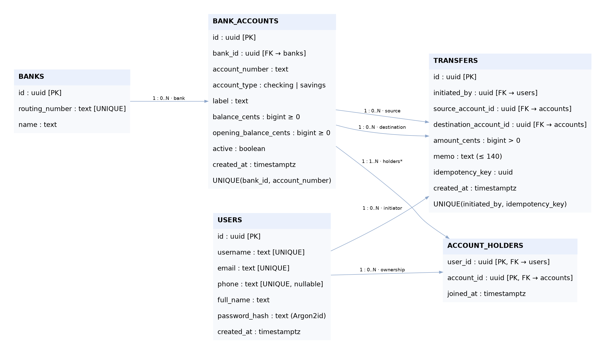

# Executive overview

PayLink is a database-driven banking simulation for sending money to another person, moving funds between owned accounts, and reviewing activity. Its central question is: **how can a relational database preserve correct balances when transfers overlap, fail, or are submitted repeatedly?** It uses synthetic accounts and USD amounts only; it does not connect to real banks or move real money.

The implementation follows the submitted proposal: Next.js/React with TypeScript for the frontend, Python/FastAPI for the backend, and PostgreSQL with five core tables. The schema and deployment instructions target a private database schema on Supabase. The current implementation supports account registration and sign-in, masked account summaries, exact recipient lookup by username/email/phone, a review-before-send flow, internal transfers, shared ownership, searchable activity, CSV download, and basic SQL-driven insights.

**Status as of October 25, 2026 (America/Chicago):** the public app is live at <https://paylink-radiant690s-projects.vercel.app>. Vercel serves Next.js, Render serves FastAPI, and Supabase PostgreSQL 17.11 hosts the private five-table schema in primary-org/paylink. On this Mac, the production build, 26 database/API tests, and 13 grouped Chromium workflow checks passed. Nine public-browser acceptance groups verified the complete hosted path, committed transfer rows and both balance deltas, duplicate/rejected requests, and zero reconciliation discrepancies. The earlier Linux results are historical; current evidence is from this Mac.

This report documents the generated implementation. The division between Sai and Siddhardth below is **recommended responsibility and review ownership**, not an assertion that either teammate independently authored the generated work. The team should confirm its own actual contributions and understanding before submitting or recording.

# 1  Requirements and course alignment

The project description establishes a many-to-many relationship between users and bank accounts through account holders, including joint accounts. Banks maintain multiple accounts. Transfers must verify ownership, account status, and sufficient funds; update both balances together; and handle duplicate requests safely. The SQL lecture's project guidance specifies at least four tables, at least one one-to-many and one many-to-many relationship, appropriate keys/constraints, an ER model, and a relational schema. PayLink supplies five tables and both required relationship types.

The course emphasizes relational design, normalization, advanced SQL, storage/indexing, query optimization, transactions, concurrency control, recovery, and advanced web database development. PayLink demonstrates these through a relational model and FD analysis, constraints, joins and aggregation, window functions, B-tree access plans, row locking, atomic updates, and integration tests. It does not claim to have demonstrated NoSQL, warehousing, machine learning, crash recovery, or production performance tuning.

# 2  System architecture and implementation

The browser communicates with the Next.js application using same-origin `/api` requests. Next.js forwards those to FastAPI. FastAPI verifies a signed HttpOnly session cookie, derives the acting user from the session, and uses parameterized psycopg queries against PostgreSQL. The acting user's ID is never trusted from an arbitrary browser field.

A dedicated `paylink_api` database role can read the application schema, insert registered users, and call carefully scoped account-opening, joint-ownership, and transfer functions. It cannot directly update balances, delete history, or insert transfer rows. Tables enable row-level security; backend-only policies allow the trusted service role's necessary reads/registration. PUBLIC cannot execute the balance-changing functions. Supabase's browser/Data API roles are not granted access to the private schema. These controls assume the backend role remains confidential; its credentials are privileged and must not enter the browser.

Passwords are hashed with Argon2id. The backend uses signed HS256 sessions with expiration, issuer, and audience validation. Cookies are SameSite=Strict and HttpOnly, with Secure enabled for hosted HTTPS. Mutation endpoints check the configured origin and reject cross-site fetches. A basic in-process login limiter supports the single-worker academic deployment. This is a teaching system, not a complete security or compliance solution; email/phone verification, distributed limiting, password recovery, administrative account management, and session revocation are future work.

The UI uses a consistent neutral palette, a single blue action color, masked account identifiers, explicit simulation labels, a transfer review screen, visible errors, receipt IDs, and empty states. It separates sent, received, and internal activity. A user who jointly owns both endpoints sees an internal transfer. The monthly money-in/out metrics exclude internal movements, while the weekly volume chart deliberately includes both legs and explains that distinction.

# 3  ER model and relational schema

| Entity | Primary/alternate keys | Purpose |
|---|---|---|
| Users | UUID PK; username and email UNIQUE | Identity and authentication information. Phone is optional and unique when present. |
| Banks | UUID PK; routing_number UNIQUE | A bank's independent descriptive facts. |
| BankAccounts | UUID PK; UNIQUE(bank_id, account_number) | One balance and account state per simulated account. |
| AccountHolders | Composite PK(user_id, account_id) | Ownership bridge, including joint accounts. |
| Transfers | UUID PK; UNIQUE(initiated_by, idempotency_key) | Completed transfer event connecting two different accounts. |

The Bank→Account relationship is one-to-many. Users↔Accounts is many-to-many, represented by two FKs and a composite key. An account can send and receive many transfers; a transfer has one source, destination, and initiator. The account-opening function creates the account and first owner atomically. The ER model's intended minimum of one owner is a workflow invariant, not a minimum-cardinality constraint enforced by a simple FK.

Domain checks restrict account types to checking/savings, enforce nonnegative balances and positive transfer amounts, require different source/destination accounts, and bound notes to 140 characters. All amounts use integer USD cents. Account numbers are synthetic strings, unique within a bank. Identifiers, timestamps, and account ownership are not packed into repeating text fields.

# 4  Normalization analysis

A hypothetical wide ownership relation has candidate key `(user_id, account_id)`. It repeats user identity details for each account and bank details for each owner/account. User details depend only on user_id; account facts depend only on account_id. Those partial dependencies motivate separation into Users, Accounts, and AccountHolders to satisfy 2NF. The transitive dependency `account_id → bank_id → bank_name, routing_number` motivates the separate Banks relation for 3NF.

The final design's main functional dependencies are:

- `user_id → user attributes`; username and email are alternate determinants.
- `bank_id → routing_number, bank_name`; routing_number is an alternate determinant.
- `account_id → bank_id, account_number, type, label, balances, active, created_at`; `(bank_id, account_number) → account_id`.
- `(user_id, account_id) → joined_at`.
- `transfer_id → transfer attributes`; `(initiated_by, idempotency_key) → transfer_id`.

Every nontrivial determinant is a superkey in its own relation, so the design is in BCNF under the stated dependencies. An optional UNIQUE phone is not treated as an unconditional candidate key because multiple NULLs are permitted. Sample data is not used to infer extra dependencies.

The ownership decomposition is lossless: each split shares an attribute that determines the extracted relation (user_id for Users, account_id for Account facts, bank_id for Banks). The local FD constraints remain in individual relations, making this decomposition dependency-preserving for the declared FD set. Transfers is a separate event relation; joining all ownership rows to every event would multiply joint-owner rows rather than prove losslessness.

Ownership authorization, active status, sufficient balance, and money conservation are cross-row business invariants, not consequences of BCNF. Their enforcement belongs in the transaction. A stored current balance is a deliberate materialized aggregate. A read-only reconciliation query checks that each balance equals opening balance plus incoming transfers minus outgoing transfers. Both the isolated local state after fixture cleanup and the hosted recording state have zero reconciliation discrepancies. Detailed assumptions and the full dictionary appear in `database-design.md`.

# 5  Atomicity  concurrency  and duplicate handling

The backend calls `execute_transfer` inside a database transaction. The function validates inputs, locks the user/idempotency-key pair, returns an existing identical transfer when appropriate, checks source ownership, and locks the two accounts in deterministic UUID order. It then verifies active status and sufficient funds, debits the source, credits the destination, and inserts one completed event. Failure rolls back all changes. The backend returns success only after commit.

READ COMMITTED plus explicit `FOR UPDATE` locks prevents lost updates for the supported transfer workflow. Competing payments serialize at the source row; the second checks the resulting balance. Opposing A→B and B→A requests lock accounts in the same order, reducing deadlock risk. A transaction-scoped advisory lock coordinates simultaneous retries of the same idempotency key, even when conflicting requests specify different account pairs. The unique initiator/key constraint is a further safeguard.

The Accounts screen also allows an existing owner to add a registered equal joint owner by exact username. This adds one ownership row and no funds. It locks the target user before the account, coordinating with the four-account allocation limit. Invitation acceptance and revocation remain future work.

Registration atomically creates the user, an Everyday checking account with $200 in simulated funds, and its first ownership row. Additional account creation also allocates $200, with at most four held accounts per user. That allocation changes the simulation's total supply by design. Transfers between existing accounts conserve supply. The current design records completed transfers only; rejected attempts do not become successful history rows. A separate security/audit event model and a full double-entry ledger are possible extensions, not present claims.

PostgreSQL supplies WAL-based durability and transactional recovery. Tests demonstrate rollback after balance mutations and on rejected operations. They do not establish backup restore, power-failure recovery, or hosted point-in-time recovery.

# 6  Advanced SQL  indexes  and physical observations

The included SQL exercises demonstrate bank totals using joins and GROUP BY, jointly held accounts using HAVING, exact recipient lookup, a UNION ALL/CTE reconciliation, and a deterministic running balance using `SUM(...) OVER (... ROWS UNBOUNDED PRECEDING)`. Storage inspection uses PostgreSQL relation/index-size functions and catalog statistics.

Two composite B-tree indexes cover outgoing and incoming account histories ordered by timestamp and ID. The reverse ownership index supports account-to-owner queries; the ownership PK supports user-to-account lookup. Primary and alternate keys create their own indexes.

A real local microbenchmark temporarily inserted 20,000 synthetic transfers in a transaction, measured the same outgoing-history query with and without its composite index, then rolled back the fixture rows and index drop. The captured run used an index scan with three shared buffer hits and approximately **0.009 ms** execution time. Without that index, PostgreSQL used a sequential scan plus top-N sort, with 385 shared buffer hits and approximately **1.614 ms**. These measurements describe one warm local run, not hosted performance or a general speed guarantee. The benchmark concerns the outgoing-history query, not every query used by the UI. Tiny real demo datasets may correctly use sequential scans.

# 7  Validation and limitations

The production Next.js build passed. The 26 Mac database/API checks passed, including:

- Atomic debit/credit and supply conservation; insufficient-funds rollback.
- Eight simultaneous identical requests returning one transfer; rejection of conflicting payloads.
- Two competing spends unable to overdraw; twenty opposing transfers completing without a deadlock.
- Non-owner/inactive-account rejection, positive amount validation, FK integrity, and nonnegative balance constraints.
- Joint-owner spending, denial of direct balance UPDATE, and rollback after the transfer function's mutations or a destination credit-limit failure.
- Authentication, cookie attributes, origin checks, masked account responses, and rejection of fractional cents.
- Adding joint owners with authorization, repeated/concurrent grants, and account-limit races against account opening.
- Complete registration-to-transfer API flow, internal-transfer insight totals, exact email lookup, CSV formula escaping, five-table structure, RLS, and restricted role privileges.

The browser workflow uses real Chromium rather than mocked screenshots. It exercises sending, review, confirmation, receipt lookup, reload persistence, CSV download, own-account movement, account creation, second-user receipt, mobile navigation, and registration. Database queries independently assert the exact committed amount and both balance deltas. Test fixtures are subsequently removed and balances restored. Current result files and screenshots, rather than this prose alone, are the evidence of completed checks.

Mac integration tests use a dedicated Homebrew PostgreSQL 16.15 cluster on loopback port 54322. Hosted acceptance uses Supabase PostgreSQL 17.11 through the IPv4 session pooler with full TLS hostname/certificate verification and the official public Supabase CA. The public browser has no database credentials. An explicitly enabled quick-test endpoint opens only the shared synthetic Sai and Siddhardth profiles without a password; all other profiles still require normal sign-in. Private fallback credentials remain outside Git.

A hosted $12.34 transfer was independently matched to its database event and exact sender/recipient balance changes. Identical authenticated retries returned the same ID; changed payload, insufficient funds, and a non-owned source were rejected without another debit. A second isolated session saw the receipt and spent from a newly shared account. The hosted security advisor reported no findings; informational unused-index notices on the tiny dataset are retained as workload-dependent observations. See validation.md for exact evidence and scope.

Other limits include a latest-200 history/export cap, single-worker rate limiting, immediate owner grants without invitation acceptance or revocation, no immutable audit ledger, no real banking, and no backup/restore or crash-recovery drill. The public Render free service can sleep; warm it and verify health before recording. Calendar insight buckets use America/Chicago. Production-scale hosted concurrency and performance validation remain future work.

# 8  Team ownership and incremental milestones

1. **Model the domain.** Proposal, assumptions, five entities, cardinalities, and normalization. Proposed review: Sai on keys/dependencies/integrity; Siddhardth on ER mapping and requirements. Evidence: editable model and design analysis.
2. **Build the data layer.** DDL, migrations, account opening, joint ownership, transfer invariants, seeds, and SQL exercises. Proposed review: Sai on schema/functions; Siddhardth on catalog/query examples/dictionary. Evidence: schema recreation and current database tests.
3. **Integrate the application.** Authentication, accounts, transfers, history, export, and insights. Proposed review: Sai on FastAPI/session/SQL paths; Siddhardth on Next.js flows and mobile layout. Evidence: production build and working public UI.
4. **Validate and prepare the demonstration.** Concurrency, rollback, reconciliation, query plans, screenshots, and recording materials. Proposed review: Sai on integrity and plans; Siddhardth on browser/demo/documents. Evidence: 26 Mac database/API tests, 13 local browser groups, nine hosted groups, and zero reconciliation discrepancies.

These are proposed responsibility assignments for internal knowledge transfer. Each teammate should review/run the assigned components, record actual changes and explanations, and revise the attribution accordingly. Generated code alone does not establish an individual's contribution.

# 9 Next work milestones 5 through 7

**Milestone 5 — Hosted operations and recovery.** Extend the completed public acceptance with representative hosted concurrency, startup monitoring, a documented backup/restore drill, and checks after a fresh deploy or sleeping-service restart. Hosted schema, restricted-role connectivity, public transfers, and read-only reconciliation are already verified; recovery and sustained operation are the remaining work.

**Milestone 6 — Strengthen the financial and account model.** Evaluate a separate immutable double-entry ledger and rejected-attempt audit records, add pagination and reversal workflows, formalize account lifecycle rules, and implement authenticated joint-owner invitations/revocations with coordinated locking. Each extension requires an updated ER/normalization and invariant analysis.

**Milestone 7 — Measure scale and complete course evaluation.** Introduce representative skewed workloads, repeat EXPLAIN/BUFFERS and concurrency measurements, compare indexed plans with justified alternatives, run multi-worker security/load checks, and document recovery evidence. Refine accessibility and the final presentation based on measured results.

# References and assistance disclosure

1. Team-provided *Project Proposal: PayLink — Simulated Peer-to-Peer Banking Transfers*.
2. Yu Luo, *CS 5600 Advanced Database Systems Syllabus, Fall 2026*.
3. Yu Luo, supplied lectures 01 Introduction, 02 Relational Model, 03 SQL, 04 Advanced SQL, 06 Database Design (E/R), 07 Database Design Theory, and 08 Database Design Theory.
4. PostgreSQL documentation, *Explicit Locking*, *Transaction Isolation*, *Constraints*, and *Using EXPLAIN*: <https://www.postgresql.org/docs/17/>. Framework references: <https://fastapi.tiangolo.com/>, <https://nextjs.org/docs>, <https://supabase.com/docs/guides/database>.

**AI assistance disclosure:** OpenAI Codex generated and revised application code, database functions, diagrams, documentation, tests, deployment configuration, and recording materials. Codex executed automated tests and browser checks on this Mac and configured the hosted services. The proposed Sai/Siddhardth responsibility split is a review and explanation plan, not a historical claim. Each teammate must describe only work they actually performed and follow the course's applicable AI-assistance rules. Instructor authorization and independent team review have not been verified by the assistant.
